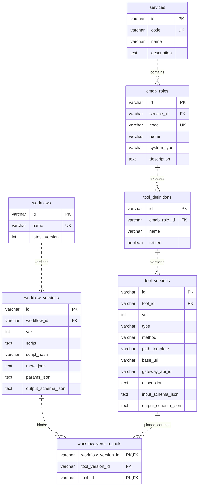
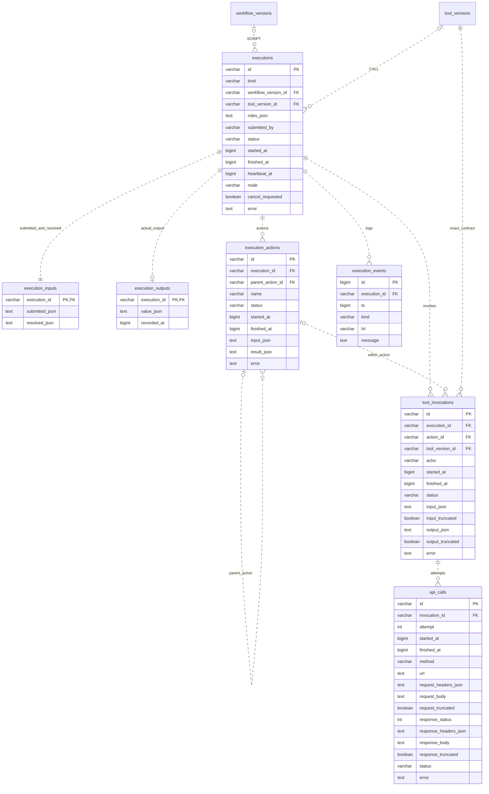
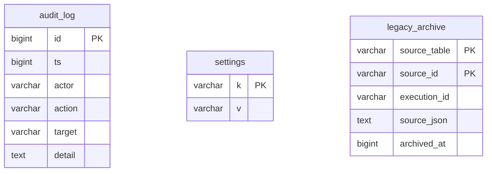

# Prod Access 领域与数据模型

本模型已同步到当前 DDL、后端、Runner 和界面。共有 **17 张表**：7 张定义表、7 张执行证据表、3 张操作审计 / 设置 / 旧数据归档表。下图省略 `created_by`、`created_at`、`updated_by`、`updated_at` 等标准审计字段；执行人和执行时间属于业务证据，保留。完整 SQL 类型、可空性及约束以 [schema.sql](../control/src/main/resources/schema.sql) 为准。

## 领域边界

| 实体 | 业务含义 | 关键约束 |
| --- | --- | --- |
| Service | 顶层业务应用，如订单服务 | `code` 唯一 |
| CMDB Role | Service 内的具体系统，可为 WEB、KAFKA、BATCH、WORKER、OTHER | 每个系统属于一个 Service；Role code 全局唯一，也是脚本命名空间 |
| Tool Definition | 某个系统提供的稳定 API 身份 | `(cmdb_role_id, name)` 唯一；停用采用退役，保留历史 |
| Tool Version | 不可变 API 契约及端点定义 | 输入 / 输出 Schema、类型、HTTP 方法、路径、Gateway 定义 ID 或自定义 base URL 随版本冻结 |
| Workflow | 一个可复用的脚本工作流定义 | 与执行实例分离；未命名 Workflow 用于临时脚本 |
| Workflow Version | 不可变脚本、参数定义、输出契约和执行限制 | 固定脚本 Hash；通过关联表绑定确定的 Tool Version |
| Execution | 一次 Workflow 执行或单 Tool 调用 | 固定定义版本、提交人、状态、运行时间与调度信息 |
| Execution Input / Output | 本次执行的输入与实际产出 | 输入保留原始提交值和校验转换值；输出保留实际值，包括输出契约校验失败时的产出 |
| Action | 脚本 `ctx.step` 的一次执行 | 支持父 Action、输入、输出、时间和结果；相同名称可多次执行 |
| Tool Invocation | 一次逻辑工具调用 | 关联执行、Action、Tool Version、调用人及输入输出 |
| API Call | 一次实际 HTTP 请求尝试 | 记录实际 URL、方法、请求与响应、开始结束时间、状态；重试为独立记录 |

Service 与 CMDB Role 是应用目录实体。团队归属和用户身份仍来自 `Cmdb` / SSO 接入点；CMDB Role 不等同于 RBAC 权限角色。跨系统 Workflow 不强制归属于某个被调用系统，权限由其依赖的全部 Role 决定。

## 定义 ER 图

FK 标记仅表示数据库声明的外键；复合约束另见下文。定义表的最少版本数量按成功提交后的服务层业务状态表示。

`workflow_version_tools` 的主键为 `(workflow_version_id, tool_id)`，保证一个 Workflow 版本只绑定同一工具的一个版本；复合外键 `(tool_id, tool_version_id)` 保证版本确实属于该工具。

Tool 的 `API_FORGE` 类型表示 API Gateway 定义，保留项目现有协议枚举名称。Gateway API 标识、HTTP 路由与契约存在同一个不可变版本中；`HTTP_CLIENT` 使用自定义 `base_url`。CHECK 约束禁止 HTTP Client 携带 Gateway ID，禁止 Gateway 类型携带自定义 base URL。当前 API Forge 连接仍是项目原有 SDK 占位客户端，并未声称已接通外部 API 目录同步。

## 执行与审计 ER 图

执行的两个入口由 CHECK 约束互斥：`SCRIPT` 必须有 `workflow_version_id`，`CALL` 必须有 `tool_version_id`。父 Action 以及调用所属 Action 使用含 `execution_id` 的复合外键，防止串到另一次执行。

### 从审计回答业务问题

| 问题 | 查询依据 |
| --- | --- |
| 谁在什么时候执行了哪个 Workflow？ | `executions.submitted_by / started_at / finished_at` → `workflow_versions` → `workflows` |
| 使用了哪些输入、产生什么结果？ | `execution_inputs.submitted_json / resolved_json`、`execution_outputs.value_json` |
| 哪个 Action 调用了哪个系统的哪个 API？ | `tool_invocations.action_id / tool_version_id` → Tool → CMDB Role → Service |
| 当时的 API 契约是什么？ | 不可变的 `tool_versions`；不会被工具后续修改覆盖 |
| 实际发出了什么 HTTP 请求，返回什么？ | `api_calls.method / url / request_* / response_*` |
| 是否发生过重试？ | 一个 Invocation 下多条 `api_calls`，`attempt` 从 1 递增；401 刷新凭证后的再次请求也单独记录 |
| 取消或超时意味着远端没执行吗？ | 不能据此认定；未收到结束证据的 Action / Invocation / API Call 标为 `UNKNOWN` |

审计写入顺序：Runner 先发送开始证据，父进程提交数据库后返回 ACK，Runner 才继续执行 Action / Tool / HTTP 请求。审计无法确认写入时停止后续调用。结束记录补充响应和结果；开始证据不会依赖请求成功后才创建。

单次调用审计的输入输出及 HTTP Body 各保留最多 128 Ki 字符；截断字段显式标记，JSON 截断使用合法的预览包装。标准凭证 Header 及常见密码 / Token 属性脱敏；URL 的常见凭证查询参数同样脱敏。因此这是可追踪的业务审计，不是原始网络报文的无损归档。执行输入输出自身仍是业务数据，部署时应沿用数据库和身份系统的访问控制。

`ctx.step` 回调收到当前 Action 的上下文。重叠执行的 Action 可用 `action.api` 调用工具，并用 `action.step` 开启子 Action，确保审计记录归属正确。`batch.each` 仍按顺序执行。一个 Action 可包含多次 Tool Invocation，每次实际 HTTP 尝试都有独立记录。

## 支持实体

`audit_log` 记录目录维护、版本发布、执行提交、拒绝和取消等用户操作。`settings` 保存全局调度暂停开关及旧数据归档完成标记。`legacy_archive` 的复合主键为 `(source_table, source_id)`；`execution_id` 是旧执行的检索线索，不伪装成新 `executions` 的外键。

## 契约与编辑器

Tool 输入 Schema 描述脚本传入的 `{path, query, headers, body}`；输出 Schema 描述脚本实际接收的响应 Body。注册时检查 Schema，调用前校验输入，成功响应后校验输出。编辑器从 Schema 生成参数和返回值类型，提供属性补全。

Workflow 脚本继续通过 `export const params` 声明带表单描述的参数；新增 `export const output` 声明返回值 Schema，未声明时为显式的无约束 `{}`。工作流参数与 API 请求 Schema 是不同层级的契约。

当前支持 JSON Schema 的明确子集：基本类型及类型数组、`properties`、`required`、`additionalProperties`、`items`、`enum`、`const`、数值上下限、字符串长度 / pattern、数组长度，以及常用注释字段。`format` 作为注释；`$ref`、组合 Schema 等未实现的断言会在保存时被拒绝，不会静默跳过。参考 [JSON Schema 类型与关键字](https://json-schema.org/understanding-json-schema/reference/type)。

## 兼容性及代码位置

- Workflow API 为 `/api/workflows`；执行入口保留 `/api/runs`，数据库实体为 `executions`。
- 工具调用审计检索为 `/api/audit/tool-invocations`，支持调用人、Service、系统、工具、状态和时间区间；执行原始 / 校验输入由 `/api/runs/{id}/inputs` 查询。
- Service / CMDB Role API 为 `/api/catalog/services`、`/api/catalog/roles`；目录维护沿用现有 CMDB 所有权授权接入点。
- [旧数据升级说明](migration.md)：不删除旧表，不把缺失的历史契约和报文补造成完整审计。
- [DDL](../control/src/main/resources/schema.sql)
- [Tool 定义及版本服务](../control/src/main/java/io/prodaccess/control/tool/ToolService.java)
- [Workflow 及依赖绑定](../control/src/main/java/io/prodaccess/control/workflow/WorkflowService.java)
- [执行及输入输出](../control/src/main/java/io/prodaccess/control/run/RunService.java)
- [审计证据写入](../control/src/main/java/io/prodaccess/control/run/ExecutionAudit.java)
- [实际 HTTP 调用及逐次证据](../common/src/main/java/io/prodaccess/common/tool/Tools.java)
